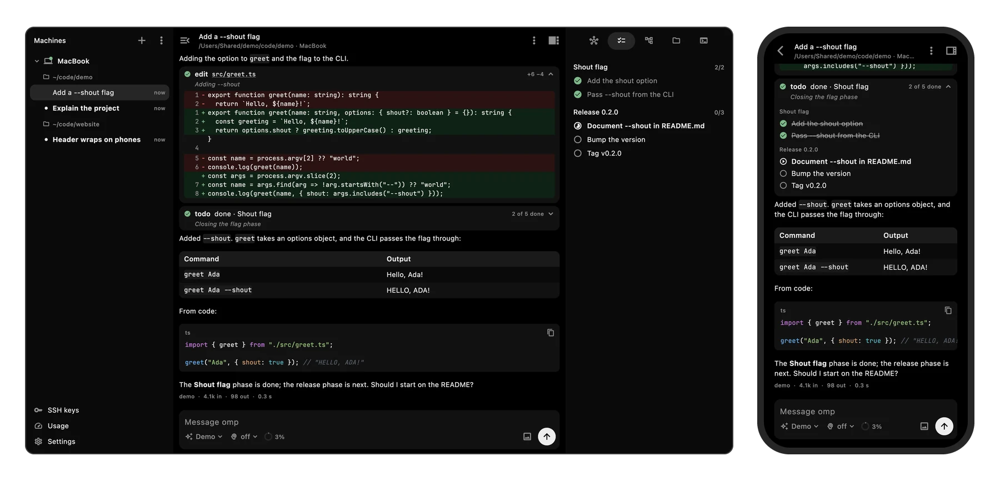

<h1>
  
  ompanion
</h1>

A GUI client for omp, the oh-my-pi coding agent, on this computer and on remote machines over SSH, jump hosts and Tailscale, with no daemon on the host.

<p>
  <a href="https://ompanion.app">Website</a> ·
  <a href="#download">Download</a> ·
  <a href="#features">Features</a> ·
  <a href="#building-from-source">Building from Source</a> ·
  <a href="LICENSE">License</a>
</p>

<p align="center">
  
</p>

## Download

<a href='https://apps.apple.com/app/id6816667970'></a>
<a href='https://ompanion.app/#google-play'></a>
<a href='https://apps.microsoft.com/detail/9P9DVTKZ3SB9'></a>

Google Play is in a closed test: [join the testers](https://ompanion.app/#google-play) first.

| Platform | Download |
| --- | --- |
| macOS | [DMG](https://github.com/edde746/ompanion/releases/latest/download/ompanion-macos.dmg), signed and notarized |
| Windows x64 | [zip](https://github.com/edde746/ompanion/releases/latest/download/ompanion-windows-x64.zip) |
| Linux x64 | [Flatpak](https://github.com/edde746/ompanion/releases/latest/download/ompanion-linux-x64.flatpak): `flatpak install --user ompanion-linux-x64.flatpak`; or the [zip](https://github.com/edde746/ompanion/releases/latest/download/ompanion-linux-x64.zip), which needs GTK 4, WebKitGTK 6 and libsecret (Ubuntu 24.04 or newer) |

Runs on macOS 13, iOS 16, Android 7 and Windows 10 1809 or newer. Windows needs the WebView2 Runtime, which Windows 11 includes.

Or build it yourself: [Building from Source](#building-from-source).

## Features

###  Chat & transcript
- Streaming transcript with markdown, LaTeX math, highlighted code, collapsible thinking and images
- A sent prompt shows in the transcript at once, above a quiet "Waiting for a reply" line that stays from sending until the model's first output, and comes back after a tool finishes until the next output; it counts the seconds once it has waited 3 s, and stays away while a tool runs, the run compacts, retries or is paused, or a dialog waits for an answer
- Finished turns fold their thinking, tool calls and interim messages under a one-line summary (time, tool calls, files edited) and open on a click
- Steer the running turn or queue a follow-up; edit or remove queued messages
- `/` command palette from the session's own command list; a slash command omp does not list is never sent to the model
- Model and thinking-level pickers, and a context and cost meter
- `!` shell and `$` Python runs on the machine, streamed into the chat
- `^` tags a model for delegation, as in omp: a list of the machine's models opens as you type, and the pick becomes a chip with the model's name; omp names it `m1`, `m2`, … for the `task` tool, and the chat shows the tag as a chip
- Pause and resume every agent of a session; Stop aborts the run and puts queued messages back into the composer
- Goal mode, guided goal and loop mode as in omp's terminal UI: `/goal`, `/guided-goal` and `/loop` from the palette or the session menu; a goal shows in the composer toolbar with its token usage, a loop with its iterations or time left, each with a menu to pause or resume, set the budget, drop, suspend or turn off; the goal tool card shows the objective, usage and completion report
- Goals and loops run on the machine: a goal keeps continuing until the model completes it, and a loop keeps repeating its prompt until its limit or condition stops it, with no device attached
- Attach by pasting, dropping or picking: files copied in Finder or Explorer, screenshots and copied images, and files and folders dropped on the chat (macOS, Windows, Linux) become chips above the text; a paste over 10 lines or 1000 characters becomes a "Pasted text" chip with a preview and "Paste inline", as in omp's terminal UI
- Attached images go to the model as images; a pasted text chip goes into the message after the typed text, and one over 256 KB into the session's `local://` store as `local://paste-N.md`; files, 100 MB at most each, reach omp as `@` mentions it reads itself (text, images, videos as a contact sheet): on this computer where they are, on another machine uploaded over SSH into the session's `local://` directory with progress, deleted with the session; folders attach on this computer only, as a listing
- Images the agent reads show in the read card; images a reply names by a path on the machine load on their own, as previews ffmpeg makes on the machine when it has ffmpeg (WebP, or JPEG and PNG), cached in memory and on disk; web images still wait for a tap
- Agent-created HTML pages show in the transcript in a sandboxed frame, with full-screen view and save as HTML; links out ask before opening, and a page whose running record remains after the app stops waits for you to run it again
- Copy messages, code and tool output; branch from any of your messages

###  Tools & approvals
- Tool cards for bash, read, edit and write with word-level diffs, eval, todo, task subagents, web search and fetch; other tools show their output and images
- Tool approvals answered inline
- The `ask` tool as a form: several questions, option previews, multi-select, your own answer and notes
- Extension dialogs (select, confirm, input, editor), status lines and toasts
- Files named in tool cards open in the Files panel at the line; task cards open the subagent in the Agent Hub

###  Sessions & branching
- Every session on a machine, grouped by project and across omp profiles, marked working, waiting for input or unread; a project stays collapsed across restarts and shows on its row when a session in it waits for input or works
- Pin sessions from any machine above the machines in the sidebar (right-click or long-press a session, or the chat's menu); pins are kept on this device and show before their machine connects. omp's own `/pin` list is separate
- Search the listed sessions of every machine by title or project path from the sidebar (Cmd/Ctrl+F)
- Resume any session on the machine, including ones started in omp's terminal UI
- On macOS and Linux machines, a session another omp process is writing (omp's terminal UI, `omp -p`, another client) is read, never written: ompanion follows the session file live, refuses to send into it, and names the terminal that holds it when omp left a breadcrumb for one. Take over starts the app's own omp for the file once that process has exited (`docs/contracts/session-writer.md`)
- Session tree: search, filters, labels, branch into a new session, and navigate with an optional summary
- Reset the conversation to any message from its menu: your own message goes back into the composer, an assistant reply becomes the point to continue from, and the replies left behind stay in the session tree (the snackbar opens it)
- Compactions show as dividers with their summary and file lists
- Several devices on one live session: each sees what the others send, and the first answer to a dialog settles it everywhere
- New sessions start in a recent project or a folder picked on the machine, optionally with a model
- Notifications when a session asks a question, finishes or fails, each kind switchable: on desktops while the app runs, for the sessions it has open; on phones as push notifications the machine sends itself, with no device connected, end-to-end encrypted through our relay (off until you turn it on); a tap opens the session

###  Machines
- This computer[^desktop], any SSH host, hosts behind a chain of jump hosts, and Tailscale peers
- No daemon: the app runs stock omp and uploads a small companion extension for what omp's RPC lacks
- Sessions run detached on the machine, so a dropped connection, a locked phone or a closed app does not stop the turn; the app reconnects and catches up
- Key, password, keyboard-interactive, SSH config and agent[^agent] and Tailscale SSH authentication
- SSH config and agent auth works like the `ssh` command: the agent from `IdentityAgent` or `SSH_AUTH_SOCK`, then the `IdentityFile` keys `~/.ssh/config` sets for the host (or the default `~/.ssh/id_*` keys), with `IdentitiesOnly`; encrypted keys ask for their passphrase and can remember it in secure storage
- A host that refuses every key names the refused keys and asks for its password or keyboard-interactive answers, like `ssh`; waiting on a prompt never counts toward the connect timeout
- On desktop, import hosts from `~/.ssh/config`, jump chains included, and peers from `tailscale status`
- Host-key checks on every hop, honouring `~/.ssh/known_hosts` on desktop
- On macOS and Linux machines, omp and the commands it runs get the PATH the account's login shell sets (Homebrew, `~/.local/bin`, version managers), over SSH as on this computer, even when the app was started from the Dock
- Probes each machine and installs omp with a checksum check, or shows the commands to run by hand
- Generate Ed25519 keys or import OpenSSH and PEM keys; private keys stay in the platform's secure storage
- Export and import machines; private keys never leave the device
- Windows hosts[^windows]

###  Dock
- Agent Hub: subagent roster with progress, tokens and cost, each agent's transcript, and steer, kill and revive
- Todos by phase
- Session tree
- Files: browse, create, rename and delete; an editor with find and replace; git status and diffs against HEAD
- Terminal tabs on the machine, over SSH or locally[^desktop]

###  Configuration
- Settings from omp's own schema, global or per project, with search and where each value comes from
- Model roles, global or per project
- Providers: OAuth login (the callback port is forwarded from remote machines), API keys, logout, and pinning an account to a session
- MCP servers: add, remove, enable, test, reload, resources, prompts and Smithery search
- Plugins and marketplaces: install, enable, upgrade and remove
- Skills: search, install, update and remove
- Stats from `omp stats`: requests, tokens and cost by model, project and agent, plus overall speed

###  Usage
- Subscription limits from every online machine in one place, one entry per account even when several machines share it
- Reset times, account priority and reserve, re-login countdowns and disabled credentials
- Refresh, or ask the providers again (`omp usage invalidate`)

###  Platform & design
- One codebase for macOS, Windows, Linux, iOS and Android: a web UI in each platform's own webview, on a Go core
- Wide windows show machines, chat and dock side by side; narrow ones show one screen at a time
- On macOS the app draws the whole window: no title bar, the window buttons sit in the sidebar's header
- Monochrome, flat design with an OLED-black dark theme and a light theme, or a custom theme with every color picked by you: surfaces, text, accent, status, diffs, syntax highlighting, the terminal's 16 colors
- Keyboard shortcuts (Cmd on Apple platforms, Ctrl elsewhere)
- English and German UI

[^desktop]: Desktop only.
[^agent]: Desktop only; reads `~/.ssh/config` through the `ssh` command (`ssh -G`). On Windows only identity files work: the OpenSSH agent's named pipe is not supported. Apple's Keychain passphrases (`UseKeychain`) are not read.
[^windows]: Covered end to end in CI against the Windows runner's own Win32-OpenSSH server, with cmd.exe or PowerShell as the default shell. The app itself on Windows runs its smoke checks in CI on x64 and arm64 runners (on arm64 without the file drop).

## Building from Source

The app is one web page (`ui/`) that each platform's shell (`shells/`) bundles and shows in the system webview, on a Go core (`core/`); [docs/app.md](docs/app.md) says how it is organised. Every build reads its version from the `VERSION` file (`<semver>+<build>`).

### Prerequisites
- [Bun](https://bun.sh) and [Go](https://go.dev) (the version in `core/go.mod`)
- macOS and iOS: Xcode 26 or newer (the app icon is an Icon Composer bundle), [XcodeGen](https://github.com/yonaskolb/XcodeGen), and gomobile: `(cd core && go install golang.org/x/mobile/cmd/gomobile golang.org/x/mobile/cmd/gobind)`
- Android: JDK 21, the Android SDK (`$ANDROID_HOME`) with an NDK, and gomobile
- Linux and Windows: Docker; both build in containers. The Flatpak needs a Linux machine with `flatpak` and `flatpak-builder`; the Windows packages need Windows with the Windows SDK and PowerShell 7
- omp 18.3.1 or newer on each machine you connect to; the app can install omp 18.16.0 on a machine that lacks it
  and update omp with `omp update` from the machine's page

### Build

```bash
scripts/build_companion.sh                       # companion/ → ui/companion/ompx.js, which the page bundles
(cd ui && bun install && bun run build)          # the page: ui/dist
shells/apple/build.sh                            # build/apple/macos/ompanion.app, build/apple/ios-simulator/ompanion.app
shells/android/build.sh                          # build/android/app-debug.apk
shells/linux/build.sh                            # build/linux-<arch>/
shells/windows/build.sh x64                      # build/windows-x64/
```

Every shell bundles `ui/dist`, so the page is built first. The page imports the companion bundle the app uploads to every machine ([docs/contracts/ompx.md](docs/contracts/ompx.md)), a gitignored build artifact: without `ui/companion/ompx.js` the page's build fails, and a build whose bundle is empty reports every machine as failed with "This build has no companion". `bun run build` is the release page; `VITE_GALLERIES=1 bun run build` adds the dev galleries and the in-page mock core ([docs/app.md](docs/app.md), Shots). `VITE_OMPANION_CHANNEL` names where a build is distributed (`direct`, the default; `appstore`; `play`), and the shells' release options build the page for their channel themselves.

| Part | Command | Output |
|---|---|---|
| Core for Apple, Android | `core/scripts/bind-apple.sh`, `core/scripts/bind-android.sh` (gomobile); the shells' `--core` runs them, and they run on their own when the binding is missing | `build/core/apple/Ompcore.xcframework`, `build/core/android/ompcore.aar` |
| Core for Linux, Windows | the shells' `build.sh` builds `core/capi` in their container, next to the shell; `core/scripts/build-capi.sh` (Docker) builds it alone | `build-capi.sh`: `build/core/{linux-arm64,linux-amd64,windows-amd64}/` |
| macOS, iOS | `shells/apple/build.sh [--core] [--debug] [--release] [--device [--team <id> [--for <udid>]]] [--ipa] [--channel <name>]`: by default macOS and the iOS simulator, arm64, ad-hoc signed; `--release` the universal macOS release app with Sparkle; `--device` iOS devices, unsigned, or with `--team` signed for that team's registered devices; `--ipa` the App Store archive and IPA. The script's header lists the details | `build/apple/{macos,ios-simulator,macos-release,ios-device}/ompanion.app`, `build/apple/ipa/ompanion.ipa` |
| Android | `shells/android/build.sh [--core] [--release]`: a debug APK for every ABI; `--release` the R8-minified APKs (`direct`) and the Play bundle (`play`), signed with `shells/android/key.properties` when it is there, else with the debug key | `build/android/app-debug.apk`, `app-release-universal.apk`, `app-release-arm64.apk`, `app-release.aab` |
| Linux | `shells/linux/build.sh [arm64] [amd64]` (Docker, Ubuntu 24.04) | `build/linux-<arch>/` |
| Linux packages | `shells/linux/flatpak/build-flatpak.sh` on Linux, after `build.sh` for that machine's architecture | `build/ompanion-linux-<x64\|arm64>.flatpak`, `.zip` |
| Windows | `shells/windows/build.sh [x64] [arm64]` (Docker, llvm-mingw) | `build/windows-<arch>/` |
| Windows packages | `shells/windows/msix/build-msix.ps1` on Windows, after `build.sh x64 [arm64]` | `build/windows-package/ompanion-windows.msixbundle` (unsigned, for the Store), `ompanion-windows-x64.zip` |

<details>
<summary>Dev machine</summary>

Run the page in a desktop browser against the real core and an isolated omp home with the fake provider, never your real `~/.omp`. It needs the tested omp [release binary](https://github.com/can1357/oh-my-pi/releases) for your platform (the version in `harness/omp-version`, or `$OMP_VERSION`) in `.tools/omp/<version>/`; `scripts/fetch_omp.sh` downloads it there and checks it against the release's `SHA256SUMS.txt`.

```bash
scripts/fetch_omp.sh darwin-arm64                          # or linux-x64, linux-arm64
bun harness/fake-provider/server.ts --port 18999 --demo    # keep it running
harness/dev-machine.sh /tmp/omp-dev-home 18999             # prints HOME=… and OMP=…
(cd core && OMPANION_LOCAL_HOME=/tmp/omp-dev-home OMPCORE_DATA_DIR=/tmp/ompanion-data \
  OMPCORE_CACHE_DIR=/tmp/ompanion-cache go run ./cmd/devbridge -static ../ui/dist)
open 'http://127.0.0.1:8787/?devbridge=ws://127.0.0.1:8787/bridge'
```

The dev bridge (`core/cmd/devbridge`, [docs/contracts/bridge.md](docs/contracts/bridge.md), Dev bridge) serves the core over a WebSocket on loopback and plays the shell's part, with secrets in memory. `OMPANION_LOCAL_HOME` makes "this computer" run every command with that `HOME` (`ui/src/app/dev_overrides.ts`); `OMPCORE_DATA_DIR` and `OMPCORE_CACHE_DIR` keep the app's documents and cache away from an installed app's. With `bun run dev` in `ui/` instead of `-static`, open Vite's address with the same `?devbridge=`. Start the dev bridge without provider API keys in its environment: with a key set, picking a real model makes a paid call. [harness/README.md](harness/README.md), section "Dev machine", covers the demo scenarios.

</details>

<details>
<summary>Push notifications</summary>

Phone push needs a Firebase project and the relay ([docs/contracts/push.md](docs/contracts/push.md), [relay/README.md](relay/README.md)). A build without the two config files below has no push; the settings switch says "not configured". Nothing about Firebase runs on a phone until the user turns push on.

1. Firebase console: add a project (Google Analytics is not needed), then an Android app with package `com.edde746.ompanion` and an iOS app with bundle ID `com.edde746.ompanion` and team `G88U5B5783`. Take the values from the downloaded `google-services.json` and `GoogleService-Info.plist`; neither file goes into the repository.
2. `shells/android/firebase.properties` (a file missing a key fails the Gradle build):
   ```properties
   projectId=<project ID>
   applicationId=<Android app ID, 1:<number>:android:<hex>>
   apiKey=<API key>
   senderId=<project number>
   ```
3. `shells/apple/Firebase.xcconfig`, included optionally by `shells/apple/iOS.xcconfig`:
   ```
   FIREBASE_GOOGLE_APP_ID = <GOOGLE_APP_ID, 1:<number>:ios:<hex>>
   FIREBASE_GCM_SENDER_ID = <GCM_SENDER_ID>
   FIREBASE_API_KEY = <API_KEY>
   FIREBASE_PROJECT_ID = <PROJECT_ID>
   ```
   The values are public client configuration: commit both files.
4. APNs: developer.apple.com → Keys → `+` with Apple Push Notifications service; upload the `.p8` with its key ID and the team ID in Firebase → Project settings → Cloud Messaging → Apple app configuration. One key covers sandbox and production.
5. Signing: the first signed iOS build registers `com.edde746.ompanion.NotificationService` and turns on Push Notifications for `com.edde746.ompanion` through Xcode's automatic signing. If it cannot, do both by hand in the developer portal.

</details>

<details>
<summary>Strings and icons</summary>

The app's strings are `ui/src/app/i18n/en.i18n.json` and `de.i18n.json`, with the same keys. After changing the English file, regenerate the strings' types (`ui/src/app/i18n/strings.g.ts`; `bun run typecheck` and `bun run build` fail while it is stale):

```bash
(cd ui && bun run i18n)
```

A new language is `ui/src/app/i18n/<code>.i18n.json` next to them with the same keys, its code in `AppLocale`, `appLocales` and the loaders in `ui/src/app/i18n/i18n.ts`, and its name for itself in `languageEndonyms` (`ui/src/app/language.ts`); the settings offer it.

After changing the app icon in `assets/ompanion.svg` or `assets/ompanion_glyph.svg` (needs `rsvg-convert` and ImageMagick):

```bash
scripts/generate_icons.sh
```

</details>

<details>
<summary>Tests</summary>

```bash
(cd ui && bun run typecheck && bun run test)
(cd core && go vet ./... && go test -race ./...)
(cd companion && bun run typecheck && bun test)
```

The end-to-end tests start omp with the fake provider, the core's dev bridge, and two OpenSSH servers on loopback (`harness/studio-sshd.sh`); they need this computer's omp in `.tools/` and the companion bundle:

```bash
scripts/fetch_omp.sh darwin-arm64                   # linux-x64 on an x64 Linux host
scripts/build_companion.sh
(cd ui && bun run test:e2e)
(cd companion && bun run test:e2e)
```

Each shell's `smoke.sh` runs the app's smoke checks on a device ([docs/contracts/bridge.md](docs/contracts/bridge.md), Smoke runs). [AGENTS.md](AGENTS.md), "Tests", lists every suite. [.github/workflows/ci.yml](.github/workflows/ci.yml) runs them for every push and pull request to `main`; [build.yml](.github/workflows/build.yml) builds each platform on demand. The transcript benchmark is [bench/BENCH.md](bench/BENCH.md).

</details>

<details>
<summary>Releasing</summary>

A release is one command on a Mac: `uv run scripts/release/deploy.py release --version 1.1.0` (The stores, below). It sets `VERSION`, pushes main and runs Actions → Build → Run workflow on main with every platform selected and the release tag set to that version, which can also be done by hand. Before building anything the run checks the branch, the tag (it must equal `VERSION`'s version and not exist yet), the platforms, and the macOS signing secrets, the update key and the Android signing secrets below. It then attaches `ompanion-android.apk`, `ompanion-ios.ipa`, `ompanion-macos.dmg`, `ompanion-windows-x64.zip`, `ompanion-linux-x64.flatpak`, `ompanion-linux-x64.zip` and `appcast.xml` to a draft release. Publishing the draft creates the tag on the commit that was built, and offers the release to installed Mac apps.

[build.yml](.github/workflows/build.yml), run from Actions → Build → Run workflow, builds the universal macOS app (`shells/apple/build.sh --release`), signs it with `scripts/sign_app.sh` and `shells/apple/Entitlements/macOS.entitlements`, notarizes the app and the DMG, and staples the tickets so Gatekeeper accepts the DMG in the artifact named `ompanion-macos-<sha>`. It reads six repository secrets, the same names [Plezy](https://github.com/edde746/plezy) uses:

| Secret | Value |
|---|---|
| `MACOS_CERTIFICATE_BASE64` | the Developer ID Application certificate and its private key as a base64 `.p12` |
| `MACOS_CERTIFICATE_PASSWORD` | the password set when exporting that `.p12` |
| `KEYCHAIN_PASSWORD` | any password; locks the throwaway keychain the build creates and deletes |
| `APPLE_ID` | the Apple ID that owns the certificate |
| `APPLE_APP_SPECIFIC_PASSWORD` | an app-specific password for that Apple ID |
| `APPLE_TEAM_ID` | the ten-character Team ID of the developer account |

Export the certificate from Keychain Access: *My Certificates* → "Developer ID Application: …" → File → Export Items → `.p12`, with a password. Then:

```bash
base64 -i cert.p12 | pbcopy      # MACOS_CERTIFICATE_BASE64
```

The app-specific password comes from [appleid.apple.com](https://appleid.apple.com) → Sign-In and Security → App-Specific Passwords → `+`. Apple shows it once; a lost one is replaced, not recovered. The Team ID is under Membership details at [developer.apple.com/account](https://developer.apple.com/account).

Without all six secrets the macOS job still builds and uploads an unsigned DMG, and the annotation says so; with only some of them it fails and names the missing ones. A fork's runs read the fork's own secrets.

Installed Mac apps update themselves through [Sparkle](https://sparkle-project.org) 2.10.0, a Swift package of the macOS app started in `shells/apple/Sources/macOS/main.swift`. A release build reads `appcast.xml` from the latest published release (`SUFeedURL` in `shells/apple/project.yml`) at launch once a day has passed since its last check, and every day while it runs; "Check for Updates…" in the app menu checks at once. A draft is not the latest release, so a release reaches installed apps when its draft is published. Sparkle shows the release notes (the release's page as [gh-html.edde746.dev](https://gh-html.edde746.dev) renders it), downloads `ompanion-macos.dmg`, and replaces the app only if the DMG's EdDSA signature verifies against `SUPublicEDKey` (`shells/apple/project.yml`) and the new app's code signature is valid. Debug builds never start the updater.

The macOS job signs the stapled DMG with the update key, checks that signature against the built app's `SUPublicEDKey`, and writes `appcast.xml` next to the DMG in `ompanion-macos-<sha>`: one item with the version, the build number Sparkle compares, the minimum macOS version, the release notes link, and the DMG's download URL, size and signature. The key is one more repository secret:

| Secret | Value |
|---|---|
| `SPARKLE_PRIVATE_KEY` | the private half of `SUPublicEDKey`: a base64 32-byte Ed25519 seed, the format Sparkle's `generate_keys -x` exports |

Without it the job skips the appcast and warns, and a release does not start. GitHub never shows a secret again, so keep the key in your keychain or password manager as well: it was generated into `~/ompanion-sparkle-private-key.txt` on the maintainer's Mac, so store that file's line there and delete the file. A lost key cannot be replaced for installed apps: a new key means a new `SUPublicEDKey`, which reaches users only through a manual download. To sign by hand, import the key into the login keychain with the tools in the `bin` folder of Sparkle's [release archive](https://github.com/sparkle-project/Sparkle/releases/tag/2.10.0), from a Terminal window on that Mac (the keychain asks for permission in a dialog, so not over SSH):

```bash
./bin/generate_keys --account ompanion -f ompanion-sparkle-private-key.txt   # prints the public key: it must equal SUPublicEDKey
./bin/sign_update --account ompanion ompanion-macos.dmg
```

`--account ompanion` keeps the key apart from another app's key under Sparkle's default account.

The Android job signs the APKs and the Play bundle with the upload key when four repository secrets are set, again the same names [Plezy](https://github.com/edde746/plezy) uses:

| Secret | Value |
|---|---|
| `ANDROID_KEYSTORE_BASE64` | the upload keystore as base64 |
| `ANDROID_STORE_PASSWORD` | that keystore's password |
| `ANDROID_KEY_PASSWORD` | the key's password |
| `ANDROID_KEY_ALIAS` | the key's alias |

```bash
keytool -genkeypair -v -keystore upload-keystore.jks -alias ompanion -keyalg RSA -keysize 4096 -validity 10000
base64 -i upload-keystore.jks | pbcopy      # ANDROID_KEYSTORE_BASE64
```

Keep the keystore and its passwords: with [Play App Signing](https://support.google.com/googleplay/android-developer/answer/9842756) Google holds the app signing key, and losing the upload key means asking Google to reset it. Locally the same four values live in `shells/android/key.properties` (gitignored, `storeFile` relative to `shells/android/app`). Without all four secrets the job builds a debug-signed APK and bundle and warns; with only some of them it fails and names the missing ones. The job runs `shells/android/build.sh --release`, which also builds the Play bundle (the `play` channel), and uploads that as `ompanion-android-aab-<sha>`, which no release carries: the release pipeline (The stores, below) uploads it to Google Play.

The iOS job builds the unsigned `direct` app (`shells/apple/build.sh --device --channel direct`) and zips it into `ompanion-ios.ipa`; whoever installs it signs it.

The Linux job packs `shells/linux/build.sh amd64`'s build into `ompanion-linux-x64.flatpak` and `ompanion-linux-x64.zip` with [shells/linux/flatpak/build-flatpak.sh](shells/linux/flatpak/build-flatpak.sh) and the manifest next to it (the GNOME 51 runtime from Flathub), installs the Flatpak, and runs [shells/linux/flatpak/check-flatpak.sh](shells/linux/flatpak/check-flatpak.sh) in its sandbox: every library of the app resolves in the runtime, and `flatpak-spawn --host` reaches the host. The Flatpak is the `direct` build: "this computer" starts omp, its commands and the terminal's shell on the host through `flatpak-spawn --host` (the manifest's `org.freedesktop.Flatpak` permission, which lifts the sandbox), and reads the host's files at their own paths (`--filesystem=host`). Locally, on an x64 or arm64 Linux machine with Docker, `flatpak` and `flatpak-builder`:

```bash
flatpak remote-add --user --if-not-exists flathub https://dl.flathub.org/repo/flathub.flatpakrepo
shells/linux/build.sh
shells/linux/flatpak/build-flatpak.sh                  # build/ompanion-linux-<x64|arm64>.flatpak and .zip
flatpak install --user build/ompanion-linux-x64.flatpak
dbus-run-session -- shells/linux/flatpak/check-flatpak.sh
```

The Windows job cross-builds x64 and arm64 in Docker, then packs them on a Windows runner with [shells/windows/msix/build-msix.ps1](shells/windows/msix/build-msix.ps1) into `ompanion-windows-x64.zip` and the unsigned `ompanion-windows.msixbundle`, uploaded as the artifact `ompanion-windows-msix-<sha>`, which no release carries. The pipeline's `msstore` phase submits it; without the pipeline it is uploaded by hand in Partner Center. The Store signs the bundle after certification. `build-msix.ps1 -EmitManifestOnly` writes only the manifests, on any system with PowerShell 7. The package identity must match the name reserved in Partner Center: [store/README.md](store/README.md), Microsoft Store.

### The stores

[scripts/release/deploy.py](scripts/release/deploy.py), a port of [Plezy](https://github.com/edde746/plezy)'s pipeline, releases to the App Store, Google Play, the Microsoft Store and GitHub from a Mac. It needs [uv](https://docs.astral.sh/uv/), `gh` signed in to GitHub, Bun, Go, XcodeGen, Xcode with the Apple Distribution certificate of an account that can reach `com.edde746.ompanion` (the app signs automatically with team `G88U5B5783`), and Claude Code's `claude` CLI when a store's notes must be written:

```bash
uv run scripts/release/deploy.py release --version 1.1.0 --dry-run   # print every action, perform none
uv run scripts/release/deploy.py release --version 1.1.0             # release; asks before publishing
uv run scripts/release/deploy.py release                             # resume after a failure
uv run scripts/release/deploy.py status
python3 scripts/release/test_deploy.py                               # its tests; CI runs them
```

The phases run in this order. `--only` and `--skip` pick some; `build/deploy/state.json` records the finished ones, so a failed run resumes where it stopped, and `--fresh` discards it. A bare `release` repeats the saved selection; `--only` or `--skip` replaces it.

| Phase | What it does |
|---|---|
| `preflight` | checks the branch (main), uncommitted changes (only the notes files below may have some), the version, the tag, and the tools and `.env` keys of the phases that will run |
| `changelog` | writes the store notes files (below) |
| `bump` | sets `VERSION` to `<version>+<build>`, the build number one above the current one unless `--build-number` is given; commits it with the four notes files as `chore(release): <version>`; pushes main |
| `farm_start` | runs Actions → Build on main with the release tag |
| `ios` | `scripts/build_companion.sh`, `bun install` in `ui/`, then `shells/apple/build.sh --ipa --core` (the `appstore` channel); uploads `build/apple/ipa/ompanion.ipa` with `xcrun altool` |
| `asc` | waits for App Store Connect to process the build, creates the version, sets What's New, attaches the build; with `--submit` it asks whether the review demo server was reset and verified ([store/README.md](store/README.md), App Store step 11), then submits for review; without it the phase stays pending until `release --submit` |
| `farm_wait` | waits for the run and downloads `ompanion-android-aab-<sha>` and `ompanion-windows-msix-<sha>`, only from a release run: that run does not start without the four Android signing secrets, so its bundle is signed with the upload key |
| `play` | uploads that bundle through the Play Developer API and releases it on `PLAY_TRACK`, status completed, with the en-US notes |
| `release` | checks that the draft release holds exactly the seven files above and sets its notes |
| `msstore` | creates a submission through the Microsoft Store Submission API, replaces its package with that `ompanion-windows.msixbundle`, sets What's new, pins the price to `MSSTORE_PRICE_ID` and checks the price the API stored, commits |
| `publish` | publishes the draft and marks it latest, after asking |

The release notes are committed files. Write the GitHub notes; a store's file is kept when it is new or changed since the last release tag (the highest one below the version, after fetching tags from GitHub) and fits its limit, and otherwise `changelog` generates it from the GitHub notes with `claude`:

| Notes | File | Limit (characters) |
|---|---|---|
| GitHub release (`--notes` names another source) | `store/release-notes/<version>.md` | none |
| Google Play | `store/fastlane/android/metadata/android/en-US/changelogs/<build>.txt` | 500 |
| App Store What's New | `store/fastlane/ios/metadata/en-US/release_notes.txt` | 4,000 |
| Microsoft Store What's new | `store/microsoft/release_notes.txt` | 1,500 |

`.env` in the repository root (gitignored) holds the credentials of the pipeline and of the fastlane lanes:

| Key | Value |
|---|---|
| `APP_STORE_CONNECT_API_KEY_KEY_ID`, `APP_STORE_CONNECT_API_KEY_ISSUER_ID`, `APP_STORE_CONNECT_API_KEY_KEY_FILEPATH` | an App Store Connect API key: [Users and Access → Integrations → App Store Connect API](https://developer.apple.com/help/app-store-connect/get-started/app-store-connect-api) → Team Keys → `+`, then the key ID, the issuer ID and the downloaded `.p8` |
| `FASTLANE_USER`, `FASTLANE_APPLE_APPLICATION_SPECIFIC_PASSWORD` | fastlane only: instead of the API key, the Apple ID and an app-specific password for it |
| `PLAY_JSON_KEY_PATH` | the Play service account's JSON key: [create it](https://developers.google.com/android-publisher/getting_started) in Google Cloud and invite the account in Play Console → Users and permissions |
| `PLAY_TRACK` | the Play track the pipeline releases on: the closed-testing track's id from Play Console (`alpha` for the default closed track) until production access is granted, then `production`; without it `preflight` stops |
| `MSSTORE_TENANT_ID`, `MSSTORE_CLIENT_ID`, `MSSTORE_CLIENT_SECRET` | the Azure AD application associated with the Partner Center account ([Submission API prerequisites](https://learn.microsoft.com/en-us/windows/uwp/monetize/create-and-manage-submissions-using-windows-store-services)); the account is Plezy's, so it is the application Plezy's pipeline uses |
| `MSSTORE_APP_ID` | `9P9DVTKZ3SB9`, ompanion's Store ID |
| `MSSTORE_PRICE_ID` | `Tier1052`, the Partner Center price tier for US$4.99 ([store/README.md](store/README.md), Later releases) |

The fastlane lanes in `store/fastlane/` stay for the whole listing (texts and screenshots) and for uploads by hand. fastlane finds them only from `store/`:

```bash
gem install fastlane
cd store
fastlane ios deploy_appstore                                  # shells/apple/build.sh --ipa, metadata and screenshots
fastlane android release                                      # internal testing track, draft release
fastlane android release track:production release_status:completed
```

`store/fastlane/ios/metadata` and `store/fastlane/ios/screenshots` are the App Store listing; `store/fastlane/android/metadata/android` is the Play listing. A new Play app only accepts a draft release, so the Android lane's default uploads to internal testing as a draft that is rolled out in Play Console, and it builds its own bundle (`shells/android/build.sh --release --core`), signed only with `shells/android/key.properties` in place. The iOS lane never submits for review: it uploads the build, and the submission happens in App Store Connect with the notes and the demo machine from [store/README.md](store/README.md).

`deploy_appstore` signs like the pipeline's `ios` phase. fastlane rejects screenshots whose pixel size its own list does not know, so `fastlane ios deploy_appstore skip_screenshots:true` uploads everything else and leaves the screenshots to App Store Connect by hand.

</details>

## Contributing

See [AGENTS.md](AGENTS.md) for the conventions (writing, code and tests), [docs/PLAN.md](docs/PLAN.md) for the architecture and its decisions, and [docs/app.md](docs/app.md) for how the app is organised. [docs/parity.md](docs/parity.md) maps every omp feature to the route the app reaches it by.

## License

ompanion is licensed under [GPL-3.0](LICENSE).

No GPL, LGPL or AGPL third-party code and no code without a known licence ships in any build; the MPL-2.0 syntax
grammars `hcl` and `terraform` ship as file-level copyleft, and on Linux the system's LGPL libraries (WebKitGTK, GTK,
GLib, libsecret) are linked dynamically, not bundled. Settings > About > Open-source licenses lists everything a build
bundles with its licence text: the interface's packages and grammars, the Go core's modules and the platform's native
libraries. [docs/research/licenses.md](docs/research/licenses.md) records the scan of every build.

## Acknowledgments

- Drives [omp (oh-my-pi)](https://github.com/can1357/oh-my-pi)
- UI by [Solid](https://www.solidjs.com) and [Vite](https://vite.dev), shown by each platform's own webview: WKWebView, Android System WebView, [WebKitGTK](https://webkitgtk.org) and [WebView2](https://developer.microsoft.com/microsoft-edge/webview2)
- SSH and SFTP by Go's [x/crypto/ssh](https://pkg.go.dev/golang.org/x/crypto/ssh) and [pkg/sftp](https://github.com/pkg/sftp); terminals by [creack/pty](https://github.com/creack/pty), [charmbracelet/x/conpty](https://github.com/charmbracelet/x) and [xterm.js](https://xtermjs.org); the core reaches the phones through [gomobile](https://pkg.go.dev/golang.org/x/mobile/cmd/gomobile)
- Markdown by [markdown-it](https://github.com/markdown-it/markdown-it) and [KaTeX](https://katex.org); code highlighting by [Shiki](https://shiki.style); code viewing and editing by [CodeMirror](https://codemirror.net)
- Updates on macOS by [Sparkle](https://sparkle-project.org); push on phones by [Firebase Cloud Messaging](https://firebase.google.com/docs/cloud-messaging)
- App icons from [Material Symbols](https://fonts.google.com/icons) through [@material-symbols/svg-400](https://www.npmjs.com/package/@material-symbols/svg-400) (Apache-2.0); code font [JetBrains Mono](https://www.jetbrains.com/lp/mono/) (OFL-1.1)
- README section icons from [Material Icons](https://github.com/google/material-design-icons) (Apache-2.0)
