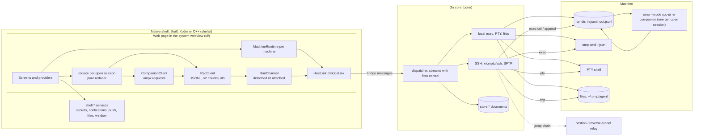

# ompanion — plan

GUI client for [omp](https://github.com/can1357/oh-my-pi) with TUI parity, driving omp on many
machines without a host daemon. Reference product: [T3 Code](https://github.com/pingdotgg/t3code),
limited to omp.

Status: the app is one web page in thin native shells over each platform's system webview, on a Go core (§3, D17).
Releases 1.0.0 to 1.2.1 were a Flutter app (git history, commit `359d920`); this app does what 1.2.1 did and imports
its data on its first launch (`app.md`, Flutter data import). This file is the plan the app was built to and still
names surfaces that are not built. What the app does is the README's feature list; the status paragraph of
`parity.md` says which omp features have no surface of their own. The companion implements more verbs than the app
calls: nothing calls `sessions.list`, `session.fork`, `session.clear`, `session.delete`, `context.breakdown`,
`history.search`, `btw`, `queue.get`/`queue.pop`, `goal.set`, `goal.guided` or `loop.enable` (the app starts a goal or
a loop through the typed command; `contracts/ompx.md`). Releases go to GitHub, the App Store, Google Play (closed
test) and the Microsoft Store through one pipeline (§9). Notifications are built (M10). Phone builds carry the
Firebase project's config (`shells/android/firebase.properties`, `shells/apple/Firebase.xcconfig`), and the relay runs
at `push.ompanion.app` (`relay/README.md`). Messages sent through it reached a Pixel 7 and an iOS 26.5 simulator, and
their taps opened the session, on 2026-11-02; a physical iPhone is untested (§14). M0's spike results are in
`research/`. Numbers were measured on 2026-09-25 (omp 18.3.0 installed, source read at tags v18.3.0 and v18.3.1)
unless dated or marked [INFERENCE].

| Doc | Contents |
|---|---|
| `app.md` | how the app is organised: the page, its conventions, the Flutter data import |
| `parity.md` | the parity contract: every omp feature, its route, its surface, its milestone |
| `design.md` | the UI rules |
| `contracts/` | wire contracts: `bridge.md` (page, core and shells), `ompx.md` (companion), `push.md`, `host-launch.md`, `session-writer.md`, `activity-stats.md` |
| `research/omp-surface.md` | RPC commands and frames, slash commands, CLI `--json`, approval frames, keybinding actions |
| `research/companion-reach.md` | what a companion extension can reach in 18.3.1, API paths, what stays unreachable |
| `research/integration-options.md` | RPC vs CLI vs files vs companion vs daemon, install paths |
| `research/remote-transport.md` | SSH libraries, jump hosts, Tailscale, T3 Code's remote design, detached sessions |
| `research/windows-hosts.md` | Win32-OpenSSH behaviour, probes, install, attached and detached sessions |
| `research/voice.md` | omp voice and live mode, what a phone must do instead |
| `research/web-ui/` | the web app against the Flutter app: sizes, startup, transcript frames and memory (D17) |

The research docs record every option considered, including rejected ones. This file records the
decisions.

## 1. Goal

- Every omp feature a TUI user can reach is reachable in the app, except the ones excluded in
  `parity.md` by decision.
- Machines: this computer (desktop), SSH, SSH through jump hosts, hosts behind NAT reached through a
  reverse tunnel, Tailscale.
- Client platforms: macOS, Linux, Windows, iOS/iPadOS, Android.
- Host platforms: macOS, Linux, Windows.
- Beyond omp: integrated terminal, file explorer and editor, port forwards, notifications (push on phones, local on
  desktops, and usage-limit reset reminders every device schedules itself).
- omp versions: 18.3.1 and every later release as it ships. Nothing older.
- Out of scope: T3-style git/PR panels, worktree-per-thread orchestration,
  live attach to running TUI sessions, omp's `/git` overlay, `omp commit`, collab, recording and
  streaming, Codex realtime voice (omp's `/live` model), plan mode and plan review, vibe mode.

## 2. Decisions

| # | Decision | Why / cost |
|---|---|---|
| D1 | No host daemon. The app drives stock omp: one `omp --mode rpc-ui` process per open session, `omp <cmd> --json` one-shots, SFTP, PTY. | User choice. Nothing to install beyond omp and one script. Cost: every gap in RPC goes through the companion (D3), and each open session is its own process with a cold start (1.7 s locally to `ready` plus four introspection commands). |
| D2 | `rpc-ui`, not `rpc`. | Only `rpc-ui` registers the `ask` tool and hands tools a UI context. It forces `PI_NO_PTY=1`, which is correct for a pipe. `--no-ui` would silence the companion and is not used. |
| D3 | RPC gaps are closed only by a companion extension: one script the app uploads and loads with `-e` into every rpc process. No upstream omp changes. | User choice. The companion reaches the live main session through `pi.pi.AgentRegistry.global().get(pi.pi.MAIN_AGENT_ID).session`, plus settings with their schema, auth storage, the model registry, session listing, tree navigation, labels, queues, subagent control, user bash and Python, `runEphemeralTurn`, themes (`research/companion-reach.md`). Cost: it depends on omp internals and must be tested against every omp version it serves (§6). |
| D4 | Protocol v2 is mandatory. The client (`ui/src/core/rpc/`) negotiates v2 and reassembles `rpc_chunk` frames. | `get_available_models` fails on v1 with `RPC response exceeded the transport limit`; on v2 it is 8 chunks, 2,039,508 bytes, 1,039 models. Cached per machine and omp version. |
| D5 | Every session runs detached from the SSH channel: a per-session run directory, commands appended to `in.jsonl`, output appended to `out.jsonl`. POSIX hosts feed omp with `tail -f in.jsonl | omp`; Windows hosts start omp through WMI with job breakaway and a PowerShell byte pump (§5). | User choice. A dropped connection, a locked phone or a closed app no longer aborts the running turn. Both forms are built and tested in `ui/src/core/channel/`: the POSIX form against real omp and OpenSSH, the Windows form's scripts with PowerShell 7 standing in for Windows PowerShell, and the Windows form end to end on a Windows runner's own Win32-OpenSSH (R3). |
| D6 | Any device may send to a live session at any time. Appends are serialized by a short lock; every device also tails `in.jsonl` to see what the others sent. Dialogs are settled by the first answer. | User choice. omp ignores `extension_ui_response` frames with unknown ids, so a late second answer is harmless. |
| D7 | One SSH stack on every client platform: the Go core's (`golang.org/x/crypto/ssh`, `github.com/pkg/sftp`; `core/ssh.go`, `core/ssh_dial.go`), the same code in every shell: a gomobile framework on Apple and Android, a C library on Linux and Windows. "This computer" on desktop is the core's local exec and PTYs (`core/exec.go`, `core/pty.go`: creack/pty, ConPTY) behind the same `HostLink`. | One implementation instead of one per platform, and it runs on iOS and Android. Covers exec, PTY, SFTP, local forwards (`net.forward`), jump-host chains, ProxyCommand, encrypted OpenSSH and PEM keys, an ssh-agent client, keyboard-interactive, `none` auth, keepalive-based dead-peer detection and key generation (`docs/contracts/bridge.md`). App-side work, in the page: known_hosts, `~/.ssh/config` through `ssh -G`, the prompts. Remote forwards (`-R`) are not built. |
| D8 | Jump hosts are a connection property: an ordered chain, each hop with its own auth and host-key check. A host behind NAT with a reverse tunnel is a jump through the relay host to `localhost:<port>`. | Each hop is dialed through the previous one's `direct-tcpip` channel (`ssh.connect`'s `jump`), chainable. One code path for bastions and reverse tunnels. |
| D9 | Desktop reads `~/.ssh/config` through `ssh -G <alias>` and lists aliases from `Host` lines and `Include`. Phones: manual entry, pasted config, or import from a desktop. | `ssh -G` gives the effective config including `Match`, which a parser of our own would have to reimplement. |
| D10 | Tailscale through the OS client; machines are dialed over SSH by MagicDNS name or 100.x address. Discovery: `tailscale status --json` on desktop, and machine import from a desktop (records only, never private keys). A peer added from `tailscale status` uses `none` auth (Tailscale SSH), and desktop pre-trusts its `sshHostKeys`. | User choices (OS client; CLI status and import). Phones need the Tailscale app running. `none` auth is tested against an sshd that allows it, not against a tailnet (§12). |
| D11 | Port forwards per machine: automatic `-L` for OAuth callback ports during `login` is built; user-defined `-L` for previews and `-R 9224` for the browser relay are not. | RPC `login` redirects to the host's loopback (anthropic 54545, openai-codex 1455, …). Phones fall back to pasting the redirect URL. |
| D12 | Bootstrap: probe (POSIX `sh -s` script; Windows `powershell -EncodedCommand`), then install with the official installer pinned to a release and `--binary` (`-Binary` on Windows), or upload a release asset and check its SHA-256. Manual mode shows the commands. The absolute omp path is stored. Updating is omp's own `omp update`, run from the machine page by the stored omp with its directory first on PATH (`updateOmp`), then a probe. | Auto and manual install were both requested. Without `--binary` the installer prefers `bun install -g`; on Windows `-Ref` alone means a source install. Non-login shells and fresh Windows sessions miss the install dir on PATH. `omp update` replaces the `omp` its PATH resolves to, the way that one was installed (binary, Homebrew, mise, bun, npm; a Nix install says it cannot), checking the download against GitHub's digest; a binary install's old file is renamed aside, so running sessions keep their omp until it exits. |
| D13 | TUI sessions on the same machine are listed from disk and opened by resuming them in a new rpc process, unless another omp process still holds the file (D21). | User choice. Before omp 18.4.9, omp has no liveness marker for a TUI holding a session (`.lock.os` is a per-write gate); from 18.4.9 an omp that has written to a file holds an ownership lease on it (`contracts/session-writer.md`), which the app's probe does not read. So the app probes for a writer itself (D21, R6). |
| D14 | The app sends a slash command as prompt text only if the live `get_available_commands` list contains it. The companion registers its channel command, `ompx`, and `goal`, `guided-goal` and `loop`, which it runs itself; any other typed TUI-only name (`/pause`, `/tree`, `/btw`, …) is not listed and is not sent; pause and the session tree have controls of their own in the app. | 40 TUI-only builtins are not handled in RPC; sent as text they reach the model as a paid turn (#13281). RPC does not reserve those names, so the companion may claim them. |
| D15 | License GPLv3 (`LICENSE`), with no additional permissions. | User choice as the sole copyright holder, who publishes the store builds (R11). No GPL, LGPL or AGPL third-party code and no code without a known licence ships in any build; the MPL-2.0 grammars (`hcl`, `terraform`) ship as file-level copyleft (`research/licenses.md`). |
| D16 | One codebase for every store. Features a store forbids are left out by the build channel (`VITE_OMPANION_CHANNEL`, `ui/src/app/build_channel.ts`: `direct`, `appstore`, `play`, `macappstore`, `flathub`), or worked around. | User choice. Known cases: local omp and `~/.ssh` access inside the Mac App Store sandbox, host access from Flatpak, background execution on iOS, auto-update outside GitHub builds (Sparkle ships only in `direct` macOS builds). |
| D17 | The app is one web page in thin native shells over each platform's system webview (WKWebView, Android System WebView, WebKitGTK 6, WebView2), on the Go core (D7). The page: SolidJS 2 and TypeScript, plain CSS (`app.md`); markdown-it with KaTeX, a text cut into top-level blocks that each render on their own (`ui/src/markdown/`); Shiki for highlighting; xterm.js for the terminal, which stops taking PTY output while it is behind, so the shell waits on a full PTY (`stream.pause`/`stream.resume`); CodeMirror 6 for the code viewer and editor; diffs rendered from omp's numbered diff format and `git diff`. The shells answer the platform services (secrets, notifications, push, files, window) and nothing more (`contracts/bridge.md`). | User choice, on the measurements in `research/web-ui/` (2026-11-01, against the Flutter app 1.2.1): downloads 1.7–3.6× and installs 1.9–3.4× smaller (`sizes.md`); launch to first frame 272 vs 238 ms on a Pixel 7 and 292 vs 268 ms on macOS (`startup.md`). Cost: WebKit's processes hold more memory than the Flutter app (2.0× at idle on macOS in a prototype transcript, `macos.md`); the oldest webview the app supports (iOS 16's WebKit) bounds the APIs it may use (R5); binary data crosses the bridge as base64. Earlier library choices and rejected options: `research/ui-libraries.md`. |
| D18 | Repository: `ui/` (the page; `ui/src/core/` the client core: RPC and companion clients, session store, detached runs, host scripts), `core/` (the Go core and its bindings), `shells/` (one per platform), `companion/` (TypeScript, Bun), `relay/` (the push relay, a Bun server, D24), `harness/` (fake OpenAI-compatible provider, isolated omp homes, recorded fixtures, OpenSSH test servers), `docs/`. | The app and the companion version together; one companion build serves every supported omp version (§6). The client core has no UI dependency, so protocol and transport tests run under `bun test` against the real Go core. Tests never call a paid provider: omp runs against the fake provider in an isolated `HOME`. |
| D19 | Material 3 look, monochrome. Built-in Light and Dark themes in grey scale, and one Custom theme: a base (Dark or Light) plus the colour tokens the user picked, every token pickable (`design.md`, Tokens). omp theme palettes are not used for the app's own colours. | User choice. omp's `theme` settings stay editable as TUI settings. One custom palette instead of a light and dark pair keeps the editor one list of tokens; untouched tokens follow the base. |
| D20 | The probe asks the account's login shell for its PATH once per connection (`$SHELL -l -i -c`, falling back to `-l -c`, bounded, between markers into a private file), and every launch puts that PATH in front of omp's own. On POSIX only. | An SSH exec channel's PATH is sshd's default, so Homebrew, `~/.local/bin` and nvm are missing from omp's bash tool (`gh` exit 127); the same for a Dock-launched app on macOS. `-i` because PATH commonly lives in `.zshrc`/`.bashrc`. The wrapper's own `tail`/`ps` keep sshd's PATH. Contract: `contracts/host-launch.md`. |
| D21 | A session file another omp process holds (a process with it open for writing, or omp's terminal breadcrumb with a live omp on that tty) is read, never launched into or attached to: the app shows the transcript from the file, refuses to send, and offers Take over only once that process is gone. A run of the app for that file is killed first, as is one whose omp is behind the file. POSIX only; Windows keeps the old behaviour. | Before omp 18.4.9, two writers on one session file interleave turns and each process's next rewrite drops the other's entries (measured: a terminal omp mid-turn plus the app's second omp, `session_exit` written into the terminal's live session); from 18.4.9 the second writer moves to a new file, which splits the conversation in two. omp's steering/follow-up queue is in that process's memory only, so the app says so instead of faking it. Contract: `contracts/session-writer.md`. |
| D22 | Phones get push notifications through Firebase Cloud Messaging (FCM); desktops show local notifications for the sessions they have open. Kinds: needs input, done, failed, each switchable per device. | User choice. FCM has no per-message cost; its limits are 600,000 messages a minute per project and 240 a minute or 5,000 an hour per Android device. A desktop app notifies only while it runs (macOS quits with its last window), which is also when it tails its sessions. |
| D23 | The companion in every detached run sends the pushes. A phone registers by leaving `~/.ompanion/push/<deviceId>.json` (its Firebase installation ID, its key, the kinds it wants) on each machine it connects to while push is on. Every registered phone gets every notification of the kinds it asked for, whether or not a device is attached; a phone hides only the one for the session it shows in the foreground. | No daemon (D1): while nobody is connected, the run's companion is the only host code alive. User choice over presence tracking: always push. The kinds are filtered on the machine because FCM lowers the priority of an Android install that receives high-priority messages and shows nothing. |
| D24 | A relay, the Bun server in `relay/`, runs in Docker on our own VPS behind its reverse proxy at `push.ompanion.app`; it holds the FCM service account, forwards messages and keeps no state. Payloads are AES-256-GCM encrypted with a key the phone makes, which reaches machines only over SSH. Contract: `contracts/push.md`. | Sending through FCM needs the project's service-account key, which cannot ship in the companion: anyone holding it could push to every install. User choices: run the relay on the VPS we already have; encrypt end to end. The relay, Google and Apple see a Firebase installation ID and ciphertext only. TLS and the reverse proxy are the VPS's own setup, not part of the repository. |
| D25 | Firebase Messaging is integrated natively in the shells: the Android SDK in `shells/android/`, the iOS SDK through Swift Package Manager in the iOS app only. Android decrypts and posts in its `FirebaseMessagingService`; iOS decrypts in a Notification Service Extension. Local notifications (the desktops' session notifications, every device's usage reminders) are the shells' `shell.notify*` services. A build without the Firebase config has no push and says so. | Native decryption posts within Android's few seconds per message without starting the page, and iOS needs the extension in any case to replace the encrypted placeholder. Desktop shells carry no Firebase SDK. |
| D26 | Usage reminders: the usage pane sets a reminder on a limit's reset (once, or at every reset of a window something was used in) or on an account being usable again (the reset of its last exhausted limit; once, or each time it runs out). The device schedules it with the system at the reset time omp reports (`shell.notifySchedule`): Apple and Android post it while the app is not running (Android with an inexact alarm), Windows through `ScheduledToastNotifier`, which keeps it across restarts; Linux, which has no scheduling, posts it while the app runs. Every-time reminders learn their next reset from `omp usage --json`, which the app reads while a reminder is set: in the usage pane, from a machine that comes online, after a run of a session open here ends (at most every 10 minutes per machine), and a minute after a reminder's time. | No daemon (D1), and no run may be alive when a limit resets, so the machines cannot send it. The reset time is known in advance. The next reset is never extrapolated from the window length: a rolling window starts with its next request. An exact Android alarm needs a permission granted in the system settings from Android 14 on. Usage spent from omp's own TUI reaches an every-time reminder only when the app next reads that machine's usage. |

## 3. Architecture

Layers, each owning one thing:

- Go core (`core/`, contract `contracts/bridge.md`) — processes and PTYs on this computer, SSH connections with
  jump chains, prompts and keepalives, SFTP, forwards, keys, the app's documents. Every stream has flow control
  (`stream.pause`/`stream.resume`). SSH session channels spread over extra connections to a host when sshd's
  `MaxSessions` (default 10, counting exec, shell and sftp channels) refuses one.
- Shells (`shells/`) — host the page in the system webview, bind the core, and answer the `shell.*` services the
  platform owns: secrets in its secure storage, notifications, push, file pickers and drops, the window.
- `HostLink` (`ui/src/core/transport/host_link.ts`) — `exec(command)`, `files()` (SFTP path space), `connect(host,
  port)`. One implementation, `BridgeLink`, over the core, for this computer and for SSH machines (`SshLink` drives
  `ssh.connect`).
- `RunChannel` (`ui/src/core/channel/`) — the byte stream to one omp process. `DetachedChannel` (POSIX hosts) and
  `WindowsRunChannel` launch or find the run directory, follow `out.jsonl` and `in.jsonl` from stored offsets, and
  append commands. `AttachedChannel` owns the process's stdio directly.
- `RpcClient` — skips bytes before `ready` (shell noise), negotiates v2, validates and reassembles chunks
  (64 MiB cap), puts back the images a POSIX attach stream sends once, correlates responses by device-namespaced
  ids, exposes typed frames. Tested against recorded frames (`harness/fixtures/`).
- `CompanionClient` — `ompx` requests and replies over the same channel (§6).
- `reduce` (`ui/src/core/store/reducer.ts`) — `(view, frame) → view`. Rebuilt from `get_state`,
  `get_messages_page` and `get_entries(since)` on attach; events apply on top. Offset replay is an optimisation, never
  required for correctness. A run ends at `agent_end` only when `isTerminal !== false`, or at `session_settled`.
- `MachineRuntime` (`ui/src/core/session/machine_runtime.ts`) — the connection, probe, install, companion upload,
  control process, session listing and the open sessions of one machine.

Machine records, host keys, settings, read markers and sidebar pins are `store.*` documents the core writes under the
app's data directory (`app.md`, App conventions); private keys and passwords are in the shell's secure storage
(Keychain, Android Keystore-wrapped preferences, libsecret, Windows Credential Manager). Private keys never leave the
device that created or imported them.

## 4. Machines

| Type | Reaches | Auth | Discovery |
|---|---|---|---|
| This computer (desktop) | the core's local exec and PTYs | none | automatic |
| SSH | host:port | key (in-app, or ssh-agent on desktop), password, keyboard-interactive | desktop `~/.ssh/config`, manual, import |
| SSH through jump hosts | hop chain, then target | per hop | `ProxyJump` from `ssh -G`, manual |
| Reverse tunnel | relay host, then `localhost:<port>` | per hop | manual |
| Tailscale | MagicDNS name or 100.x over SSH | SSH key or Tailscale SSH `none` | `tailscale status --json` (desktop), import |

Per-host facts the app stores after the probe: OS, arch, libc, shell, home, agent dir, absolute omp path,
omp version, the login shell's PATH (or why it could not be read: `contracts/host-launch.md`), and for
Windows the OpenSSH default shell and PowerShell version.

Liveness: the core sends the target a keepalive every 15 s and closes it as dead after 3 unanswered in a row
(`ssh.closed`); a session then reconnects with jittered backoff (1 s doubling to 30 s) and stops on auth failure.
Nothing probes on app resume or network change.

Session listing is one exec round trip (a PowerShell script on Windows): a script prints `{path, size, mtime,
profile, title, header, first}` for every `*.jsonl` under the default agent directory's `sessions/`,
`PI_CODING_AGENT_DIR`, `$XDG_DATA_HOME/omp` and every profile, reading only the first 16 KiB of each file: the fixed
title slot, the header line and the start of the first user message's text (for untitled sessions). The script
also takes `--session-dir` directories, which the app does not pass; the companion's `sessions.list` is not used.

## 5. Session processes

Closing an rpc process's stdin or stdout disposes the session, and dispose aborts the running turn
(`rpc-mode.ts` 837-840, `agent-session.ts` 4908). That is why sessions do not run on the SSH channel
itself. Measurements and the reason for each step: `research/m0-detached-sessions.md`. Code:
`ui/src/core/channel/` (run directories) and `ui/src/core/session/` (`MachineRuntime`, `LiveSession`).

### Detached runs (macOS and Linux hosts, and this computer on macOS/Linux)

Run directory `~/.ompanion/run/<runId>/`, mode 0700:

| File | Purpose |
|---|---|
| `in.jsonl` | every command from every device, one JSON line each |
| `out.jsonl` | omp's stdout through the pump, plus the app's markers: `ompanion_rotate` first in a rotated generation, `ompanion_mark` every MiB, `ompanion_exit` after omp exits |
| `err.log` | omp's and the pump's stderr |
| `meta.json` | session file, cwd, omp, companion, launch args |
| `run.sh`, `omp.pid`, `tail.pid`, `code`, `exit` | the pipeline, liveness, omp's exit code as the pipeline saw it, the run's exit code |
| `overlay.yml` | the `--config` overlay; its path in omp's command line identifies the process |
| `in.lock/` | `mkdir` lock held for one append; the holder is the one that created `held` in it (`posixLockFunctions`) |

- Launch (`openRun`, under `~/.ompanion/run/.launch.lock`): a running run whose `meta.json` names the
  session is reused. Otherwise `run.sh` starts in a new session (`setsid`, Perl's on macOS):
  `tail -f in.jsonl | { omp --mode rpc-ui --config overlay.yml --cwd <cwd> -e <companion> [--session <file>]
  [--model …] [--thinking …] 2>> err.log; echo $? > code; } | BUN_BE_BUN=1 <bun> log.js pump <run dir> …`, then records
  omp's exit code. omp runs with the login shell's PATH in front of its own, and the pipeline's `tail`/`ps` keeps
  sshd's (`contracts/host-launch.md`). The pump is the only writer of `out.jsonl` while omp runs (Pump, below). The
  launch replies with the listing of its run, so opening a session reads no other run directory.
- Listing (`listRuns`): shell builtins read every run's pid files, exit code and `meta.json`; one `stat` sizes the logs
  and one `ps` (a `tr` of `/proc/<pid>/cmdline` per live pid on Linux) reads the command lines, whatever the number of
  runs. A pid is omp's while its command line names the run's `overlay.yml`, the feeder's while it names `in.jsonl`.
- Session file: a new session starts without `--session`, so omp names its file
  (`sessions/<cwd>/<time>_<id>.jsonl`) and writes it with the first message. The first attach reads
  `get_state.sessionFile` and records it in `meta.json` before `open` returns; every later switch inside
  the run (`new_session`, `switch_session`, `branch`, fork, `/clear`, tree navigation) is recorded the same
  way, and so is the move to a new file that omp makes from 18.4.9 when another omp process owns the session file
  (`contracts/session-writer.md`). A device opening that file attaches to the run instead of launching a second omp.
- Resume: a session file launches with `--session <file>`. From 18.6.3 omp exits with `Could not restore model
  <provider/id>` when the model the session ran on is gone (a provider signed out of, a model dropped from models.yml)
  instead of continuing on another model; the app then asks which model the conversation continues on (Continue on
  another model) and launches again with that `--model`, or leaves the session closed.
- Attach: `in.jsonl` through `tail -F` from its saved offset; `out.jsonl` through the follow script (`followScript`,
  uploaded next to the companion and run by the probe's Bun, the same script on Windows hosts), which sends what the log
  holds with a plain read, then follows it with `tail -F` (BSD `tail -F` copies byte by byte; on macOS it delivers an
  append in 0.6 ms, Bun's `fs.watch` in 18 ms), and sends each image once. The generation is the one the log's first
  line names (`ompanion_rotate`), else 1, read before and after the size and the replay so a rotation in between is
  seen; an empty log is waited on for up to 300 ms, as the pump leaves a rotated one empty for 250 ms. omp writes
  one image into up to five frames (`tool_execution_end`, `message_start`, `message_end`, `turn_end`, `agent_end`). A
  frame holding image blocks of 1 KiB or more is rewritten: each image not sent yet goes first as an `ompanion_image`
  line, and the frame names it by id; an `ompanion_span` line ahead of the rewritten lines gives the frame's size in
  `out.jsonl`, so offsets stay file offsets. The stream keeps the last 64 images (`imageRefWindow`) and names each one
  it drops; `RpcFrameDecoder` puts the data back. A fresh attach to a turn with a pasted screenshot and a `read` of a
  3840×2160 PNG sent 469,094 bytes for a 1,551,960-byte log. A device's first attach to a generation over 8 MiB
  (`attachWindow`) gets a compacted replay, then follows the log from the end of its last complete line. From before
  the last 8 MiB it holds only what RPC cannot list again: `extension_ui_request` (dialogs, statuses, widgets; the
  latest status, widget and title of each key), `command_output`, and the start of each tool call still running; a
  timed dialog whose tool calls all ended is left out. From the last 8 MiB it drops each `message_update`,
  `tool_execution_update` and `subagent_progress` that a later frame of the same message, tool call or subagent
  supersedes. One JavaScript script (`logScript`) replays and pumps on every host: the app uploads it next to the
  companion as `log.<sha256>.js` and runs it with the probe's Bun (`HostProbe.bunPath`, `BUN_BE_BUN=1`, 74 ms to
  start). That is omp's standalone binary, a Bun executable, when it is one. omp installed as a package
  (`bun install -g`) is a script on POSIX and bun's `omp.exe` shim on Windows (an `omp.bunx` beside it names the
  script); both pass every argument to omp's CLI, which rejects the script's (`unknown flag: -1`), so the probe takes a
  `bun` instead: the one a launch's omp finds on POSIX (the login shell's PATH, then sshd's), the `bun.exe` beside the
  shim, else the one on PATH, on Windows. A package omp with no `bun` found needs an install (`ompProblem`). A live
  1.6 GB generation compacted to 58 lines, 647 KB, with the header on the device 0.4–0.7 s after the attach starts
  on macOS; a 1 GB log on a Windows host in 0.9 s, PowerShell included. Replayed whole, the 1.6 GB took 62 s and 3.1 GB
  of app memory. `in.jsonl` is read from 0 (open dialogs and the answers that closed them). The device then seeds the
  view from `get_state`, the session history, `get_available_commands`, `get_subagents` and the companion's `hello`,
  `state.snapshot` and `agents.list`. The history is the session file `meta.json` names, read while omp
  starts (a rebuild after a session change or a rotation gap: the file `get_state` names), plus `get_entries(since)`
  its last entry (a file over 16 MB: its last 2 MB, earlier 2 MB pages as the reader scrolls up); plain `get_entries`
  only when there is no file or omp does not know that entry, because omp refuses a response over 64 MiB and a 260 MB
  session file's history exceeds it. Every frame, and every `extension_ui_response` any device appends, goes through
  the reducer.
- Send: one long-running appender per channel, started with the attach, takes `in.lock` per line; lines over 64 KiB
  are uploaded first.
- Link loss: a session reconnects with jittered backoff (1 s doubling to 30 s) and continues from the last
  frame boundary it read, also across one rotation whose carry holds that point (the follow script streams the new
  generation from its marker, as to a device that stayed attached); a rotation that cut off frames it never read
  rebuilds the view from RPC. Refused credentials or host keys, a removed run and an omp that cannot start end the
  session.
- Stop: kill the feeding `tail`; omp drains and exits 0. Force: SIGTERM (exit 143). Detaching, closing the app and
  losing the link never stop a run; the user's Stop and the idle exit do.
- Idle exit: every run's omp gets its run directory and `MachineRuntime.idleExitMs` (1 h) in its environment
  (`contracts/host-launch.md`). After that long without a session event, companion call, pause change or roster change,
  and with nothing an exit would cut short or lose (a turn, queued messages, background jobs, the pause gate, loop
  mode, an active goal, a running subagent, an open dialog, a call in flight), the companion sends `run.idleExit` and
  stops omp as Stop does (`contracts/ompx.md`). The chat says why the session ended, and a send opens the session file
  in a new run: a cold open instead of an attach. A session that ended before its first message opens as a new one.
- Pump (`logScript`'s `pump` mode, `logLimits`): every `message_update` carries the whole message, so one 1.5 KB
  streamed answer wrote 270 KB, and a `task` call's `tool_execution_update` carries every subagent's progress (a live
  run that worked for 14 hours without settling wrote 16 GB, 12.5 GB of it these updates, up to 60 frames and 3.2 MB a
  second), and an `eval` cell running 40 subagents sent a 13.5 MB `tool_execution_update`, an `rpc_chunk` sequence, for
  each of their status changes (84 generations in under 6 minutes while omp emptied its output backlog; no device kept
  up, so every reconnect ended in a gap). The pump takes a whole `rpc_chunk` sequence as one frame. It holds each
  `tool_execution_update` and `subagent_progress` for 250 ms and writes only the newest per tool call or subagent, and
  not before the last one written for it would take at 1 MiB/s (`progressRate`): a 13.5 MB frame goes out about every
  13 s. `subagent_lifecycle`, `subagent_event`, `ompx`, `extension_ui_request` and `response` lines pass held progress
  whose id they do not hold; any other frame writes what is held first, so the log is omp's output minus superseded
  progress, in order wherever the order could change a state (on the 16 GB log: 22 % of the bytes at 60 frames a
  second, 66 % at 4). Every MiB it writes a generation mark. Neither a mark nor a rotation lands inside an `rpc_chunk`
  sequence: both wait for its last chunk, as readers take a sequence only whole and uninterrupted. At 64 MiB it rotates
  in place at a line boundary while omp's output waits in the pipe: it leaves the log as it is for 250 ms, so followers
  read it to its end (what omp wrote meanwhile comes out of the pipe at once and can fill the next generation within a
  millisecond; followers then missed 19 generations in a row), truncates it, leaves it empty for 250 ms (BSD `tail -F`
  moves to the end of a file it finds truncated, measured on macOS to skip the marker otherwise), then writes the
  marker (`generation`, `carryFrom` S, `preamble` P), P bytes of history as of S, and the old log from S, the first
  frame start in its last 8 MiB, with its marks rewritten to the new generation. A device that had read the old log to
  R ≥ S skips P + R − S bytes and goes on, a line it had only begun to read included; of a frame the follow script
  rewrote in that stretch, only the image definitions go through, as the stream counts those images sent. One behind
  S, one that had begun to read a frame the carry brings rewritten, one whose next marker is not the next generation's,
  or one that finds a mark of another generation (it read into a log rotated under it) rebuilds its view from RPC.
  Runs launched before the pump are never rotated; a restarted omp gets a new run directory, never an old `in.jsonl`.
- Garbage collection: `removeDeadRuns` deletes the directories of runs whose omp is gone. The app runs it with every
  session listing for runs whose `out.jsonl` last changed over 3 days ago (`deadRunLifetimeMs`).
- Secrets never go through `in.jsonl`: they reach the companion as 0600 files uploaded over SFTP and
  deleted after use.

### Control process

Settings, roles, accounts, login and model lists need no session. One `omp --mode rpc-ui --no-session -e
<companion>` per machine runs on an exec channel of the link, started on first use and again after it exits,
with the login shell's PATH like every other launch (`contracts/host-launch.md`). omp refuses rpc mode on a
machine with no usable model ("No models available"); the control then runs in bootstrap mode:
`--model minimax/MiniMax-M2 --api-key ompanion-bootstrap`. The model is bundled in omp's catalog and has no
discovery. `--api-key` is a runtime override that is never persisted. The channel refuses every model call (prompts other than `/ompx`, `btw` and `tree.navigate` calls, `compact`, `handoff`). After
`accounts.setKey` or a successful `login`, the next `control()` starts a normal process. After a probe found another
omp binary or version than the control runs (an update), the next `control()` ends it and starts one on the new omp,
so settings and the model list (cached per omp version) come from the omp new sessions get.

### Windows hosts (and this computer on Windows)

Same run directory layout under `%USERPROFILE%\.ompanion\run\<runId>\` (`ui/src/core/channel/windows_run.ts`,
`windows_channel.ts`). Its scripts are tested with PowerShell 7 standing in for Windows PowerShell, and end to end
against Win32-OpenSSH on a Windows runner (R3). Differences, from `research/windows-hosts.md`:

- Launch: sshd puts the channel's first process in a job with `KILL_ON_JOB_CLOSE`, so children started
  with `Start-Process`, `start` or `&` die with the channel. omp is started through WMI
  `Win32_Process.Create` with `CREATE_BREAKAWAY_FROM_JOB` (0x01000000); WMI-created processes are
  outside that job. Command line: `cmd.exe /d /s /c "<run>\run.cmd"`, which runs `powershell -NoProfile -File
  feed.ps1 | omp.cmd | pump.cmd`. `omp.cmd` runs `<omp.exe> --mode rpc-ui --config <run>\overlay.yml -e <companion>
  [--session <path>] 2>> <run>\err.log` and then writes omp's exit code to `<run>\code`, as a pipeline's `ERRORLEVEL`
  is its last stage's. `pump.cmd` runs the uploaded `log.js` in `pump` mode with the probe's Bun, a batch stage
  having an environment of its own, so `BUN_BE_BUN` never reaches omp; the pump opens `out.jsonl` itself and writes and
  rotates it as on POSIX. cmd.exe's `>>`, the form before a pump, refused every other writer and kept its own offset,
  so the log could never be rotated (measured on Windows 11 26200: a truncation fails with a sharing violation; through
  a pump it succeeds and the next lines start at byte 0). Pipes and redirection in cmd pass bytes through unchanged;
  PowerShell 5.1's do not.
- Feed: `feed.ps1` is a byte pump from `in.jsonl` (opened for reading with `ReadWrite, Delete` sharing) to stdout, polling
  every 50 ms, exiting when `in.jsonl.stop` appears. Its exit closes omp's stdin. Windows has no
  signals; closing stdin is omp's only graceful stop (`Stop-Process -Force` skips cleanup).
- Scripts run as `powershell -NoProfile -NonInteractive -ExecutionPolicy Bypass -EncodedCommand
  <base64 UTF-16LE>`, which works under a cmd, PowerShell or bash default shell. cmd caps a line at
  8191 characters, so larger scripts are uploaded over SFTP and run with `-File`.
- Attach: `out.jsonl` through the same follow script as on POSIX hosts, streamed over an exec channel, with each image
  sent once. Windows has no `tail`, so the script checks the log's size through its open handle every 50 ms and on
  each `fs.watch` event. A log that shrank, or whose first line names another generation, was rotated by the pump and
  is read again from byte 0. The launch keeps PowerShell away from the bytes: under cmd it is
  `set BUN_BE_BUN=1&& <bun> <follow.js> …`, which passes Bun's standard handles on; under a PowerShell default
  shell Bun starts through `[Diagnostics.Process]::Start` with the handles inherited, since PowerShell 5.1 re-encodes a
  native program's output. The script runs the replay itself. sshd kills the job when the channel closes. `in.jsonl`
  is read over SFTP with stat and offset reads.
- `meta.json` updates: a PowerShell script under the launch lock, taken over SFTP. A run launched before the pump
  opened its own log (no `OMPANION_PUMP` in its environment) is never rotated.
- Send: one long-running PowerShell appender per channel opens `in.jsonl` per line for writing with `Read,
  Delete` sharing, so a second appender's open fails with a sharing violation and retries: the handle is the
  append lock. SFTP cannot append while omp runs: Win32-OpenSSH's sftp-server opens for writing with
  `FILE_SHARE_WRITE` only, which fails (`error:32`, SFTP status 4) against `feed.ps1`'s read handle.
- Environment: a WMI child gets the provider's environment block, so `USERPROFILE`, `LOCALAPPDATA` and
  `PATH` are set explicitly.
- Orphans: found by the overlay path in their command line through `Get-CimInstance Win32_Process`.
- A Windows machine with Git Bash or another POSIX default shell runs the same scripts through `sh -c`; only
  cmd.exe and PowerShell as the default shell run in CI.

### Per-launch config overlay

Every run gets `overlay.yml`: the app's session settings (`MachineRuntime`'s `overlay`, dotted keys),
with `speech.enabled: false` forced (otherwise the `ask` tool speaks on the host's speaker).

## 6. Companion extension

A TypeScript extension in `companion/`, uploaded to `~/.ompanion/companion/<omp-version>/` (outside omp's
auto-discovery roots, so the user's TUI never loads it) and passed with `-e`. It imports only exported
subpaths of omp's `@oh-my-pi/*` packages, which the compiled omp serves from its own bundle.

Wire:

- App → companion: RPC `prompt` with `/ompx {"callId", "verb", "args"}`. Extension commands run before the
  agent, even while streaming, and add nothing to the transcript.
- Companion → app: `{"type": "ompx"}` frames (replies, pushed events, and requests such as `ask`) written
  through `ctx.ui.output`; a companion request is answered by an `extension_ui_response` frame that settles
  through `ctx.ui.pendingRequests`. Both are TypeScript-private fields; the companion feature-checks them and
  falls back to `setStatus("ompx", …)` frames, which carry no requests. Frames over 1 MiB are chunked by v2 up
  to 64 MiB. Contract: `contracts/ompx.md`.
- Push: the companion subscribes to `pi.on(...)` events, `AgentRegistry.onChange` and session events,
  and emits queue, roster, mode and settings snapshots.
- Detection: `ompx` appears in `get_available_commands` with `source: "extension"`; its `hello` reply
  carries the companion build and `pi.pi.VERSION`.

What it implements, by class (`not built` rows are the plan; details and API paths in `research/companion-reach.md`):

| Class | Items |
|---|---|
| Thin wrappers, built (the status paragraph at the top lists those the app does not call) | settings with schema (type, enum, default, tab, group, scope provenance), model roles, session listing, fork, `/clear`, delete, queue list and dequeue, subagent steer/kill/revive, pause and resume, user bash with streaming and `excludeFromContext`, user Python, `/btw`, prompt history search, context breakdown, logout and account lists, account pin, API-key login (`accounts.setKey`), full-fidelity `ask` via `ctx.ui.askDialog` |
| Rebuilt from session APIs, built | goal and guided goal (including continuation, completion and restore), loop (including `--while`/`--until` conditions and limits) |
| Rebuilt from session APIs, not built | `/omfg`, `/tan`, provider setup, agents dashboard, extensions control center |
| App only, no companion, not built | push-to-talk, reply TTS (§8) |
| Other routes, built | project-scope settings (edit `.omp/config.yml` over SFTP; rpc-ui watches it) |
| Other routes, not built | `/cleanse` (`omp cleanse` one-shot; `src/cleanse` is not exported) |
| Unreachable | extension TUI components |

Anything that must keep working while no device is attached runs in the companion, not the app: goal
continuation, loop iterations, the pause gate. A detached session keeps going after the phone locks;
logic in the app would stop with it.

- Pause: `agentPauseGate` from `@oh-my-pi/pi-agent-core` (bundled root export, `agent/src/pause.ts`).
  `pause()` parks every agent loop in the process (main, subagents, advisor) at its next model call or
  tool start; nothing is aborted, queued messages stay queued, `abort` still unwinds a parked run.
  `resume()`, `paused`, `pausedAt` and `onChange` give the state the app shows. One rpc process holds
  one session, so pause is per session, the same scope as the TUI's `/pause`; the app adds "pause all
  sessions on this machine" by sending it to every live run. The gate stays engaged while no device is
  attached; any device can resume.
- Goal (`companion/src/verbs/session/goal.ts`): the `/goal` and `/guided-goal` commands and the `goal.*` verbs over
  `session.goalRuntime` (`createGoal`, `replaceGoal`, `pauseGoal`, `resumeGoal`, `dropGoal`, `onBudgetMutated`) and
  `getGoalModeState`/`setGoalModeState`. As the TUI's continuation does (`interactive-mode.ts` 2377-2418), the
  companion sends `buildContinuationPrompt()` as a hidden `goal-continuation` message (`promptCustomMessage`) 800 ms
  after each terminal `agent_end` while the goal is active, gated by `goal.continuationModes` containing `interactive`
  (its default), and holds it after a continuation that repeated or lacked tool activity. It also does what rpc-ui
  leaves to the TUI: the completion bookkeeping after `goal({op: "complete"})`, and the restore when the process starts
  or switches sessions. Devices get the state from omp's `goal_updated` frame and `state.snapshot`'s `goal`.
- Loop (`companion/src/verbs/session/loop.ts`): the `/loop` command and the `loop.*` verbs; `parseLoopArgs` and the
  limit runtime from `modes/loop-limit`, `evaluateLoopCondition` from `modes/loop-condition`, the
  `prompt`/`compact`/`reset` action from settings; each iteration waits until the session is not streaming,
  compacting or finishing post-prompt work (`interactive-mode.ts` 2351-2515). The state is process-wide and not
  persisted; devices get it from the companion's `loop.changed` event and `state.snapshot`'s `loop`.
- `ui/src/core/session/goal_loop_omp.e2e.test.ts` runs a goal to completion and a loop to its limit on the tested
  omp with every device detached.
- Notifications (`companion/src/notify.ts`, D23): in a detached run the companion encrypts a notification for every
  phone registered in `~/.ompanion/push/` when a dialog opens, a run settles or a run fails, and posts it to the relay;
  `notify.test` sends one on request. Texts, triggers and the relay API: `contracts/push.md`. Usage reminders are the
  app's own (D26).
- Keep awake (`companion/src/keep-awake.ts`): on a Mac whose `~/.ompanion/keep-awake` exists, the companion holds
  `PreventSystemSleep` while omp works, so a Mac that a device's request woke from sleep stays awake for the turn. omp's
  own `PreventUserIdleSystemSleep` has no effect in that dark wake. The machine page's Power card sets the file.
  Contract: `contracts/host-launch.md` ("Keep awake").
- Credential sync (`companion/src/verbs/session/accounts.ts`): every 2 s the companion polls `agent.db`'s data
  version and reloads omp's stored credentials when another process committed. A sign-in or a stored key goes through
  the control process, and omp reads stored credentials only while it resolves a request's key, which a provider keyed
  in models.yml never does (can1357/oh-my-pi#14596): without the poll, a running session's model list lacked the new
  provider and `set_model` refused its models. A provider whose models come only from online discovery is not
  refreshed in other sessions.

Version policy: the app drives omp 18.3.1 and later (`minimumOmpVersion`, `ui/src/core/host/probe.ts`) and installs
the newest release it has digests for (`ompReleases`, `ui/src/core/host/install.ts`: 18.12.6). One companion build
serves every such release and feature-checks what it uses (`ui/src/app/sessions/companion_asset.ts`); an omp release
that breaks it needs a build of its own. The tests run the omp named in `harness/omp-version` (18.12.6), and CI's
integration job runs the UI's end-to-end tests (omp, the Go core, OpenSSH) against both that omp and the minimum. A
machine whose omp is older gets the install offer; a newer omp gets the same build and no warning.

## 7. Surfaces

Layout follows T3 Code. Desktop and tablet: a left sidebar of machines, projects and sessions with
running and waiting-for-input badges; transcript and composer in the center; a right dock with Agent
Hub, todos, session tree, files, terminal. Phone: the same screens, one at a time.

| Surface | Contents |
|---|---|
| Machines | add/edit, jump chain, keys, host-key trust, probe and install status, omp version and update, forwards, import/export |
| Session browser | all projects on a machine, search, pin, rename, delete, fork, recent-activity warning |
| Transcript | markdown, math, code, thinking, images, per-tool cards (bash, read, edit/write diff, eval, todo, task subagents, web, browser screenshots, tts), compaction dividers, virtualized |
| Composer | prompt, steer, follow-up, queue list with dequeue, attachments, `@` files, `/` palette from `get_available_commands`, model and thinking pickers, context and cost meter, push-to-talk |
| Dialogs | tool approval, `ask` (full fidelity), extension `select/confirm/input/editor`, login URL and code |
| Agent Hub | roster, progress, per-agent transcript, steer, kill, revive, usage |
| Session tree | branches, labels, branch from message, navigate with summary |
| Modes | goal (status, budget, pause/resume/drop), loop (prompt, limit, condition), pause/resume, fast, advisor, prewalk, with state in the composer bar; pause-all per machine in the sidebar |
| Config | settings, model roles, providers, MCP, plugins and marketplace, skills, memory, agents, advisor and WATCHDOG, extensions, the agent's own SSH hosts, omp's TUI theme |
| Usage and stats | `omp usage --json`; the activity stats script on omp's Bun (`contracts/activity-stats.md`), `omp stats --json` for the per-machine page |
| Terminal | PTY on the machine, tabs |
| Files | tree, viewer, editor, diff against git |

## 8. Voice

omp's voice features run on the host's mic and speaker and are TUI-only (`research/voice.md`). None of the
following is built yet (M8). The app owns audio instead:

- Push-to-talk: on-device speech recognition, text into the composer, sent as `prompt`, `steer` or
  `follow_up`. Optional host engine: upload a 16 kHz WAV, the companion transcribes with
  `modelRoles.dictation`.
- Reply speech: on-device TTS driven by `message_update` deltas, following `speech.mode`
  (`assistant`, `all`, `yield`). Optional host voices through the companion's `tts` call and SFTP.
- Live conversation: on-device voice activity detection, recognition and TTS in a loop, with barge-in
  stopping speech and optionally sending `abort`. omp's own `/live` (Codex realtime over WebRTC) is
  excluded: private endpoint, Codex Desktop client headers.

## 9. Store builds

| Channel | Constraint | Handling |
|---|---|---|
| GitHub releases (desktop) | none | full feature set; the macOS app updates itself through Sparkle from the latest release's `appcast.xml` (README, Releasing); Windows and Linux do not update themselves |
| Mac App Store | sandbox: no child processes outside the container, no `~/.ssh` | flag off "this computer"; `~/.ssh` via a user-granted folder bookmark |
| iOS App Store | no background sockets | detached sessions make this safe; reconnect on resume; notifications arrive as APNs pushes (D22) |
| Google Play | foreground-service policy | no background service; reconnect on resume; notifications arrive as FCM pushes (D22) |
| GitHub releases (phones) | the unsigned IPA is signed by whoever installs it, with whatever their profile grants; FCM on Android needs Google Play services | push works wherever the app can register with FCM; otherwise the settings switch says why |
| Microsoft Store | MSIX package: read-only install directory; files the app process itself creates under AppData go to a per-package folder only the app sees | the `direct` build, packed by `shells/windows/msix/build-msix.ps1`. The processes the Flutter app's MSIX started carried no package identity (measured on the probe, the omp install and omp; the terminal's ConPTY spawn sets no desktop-app policy either), so they saw the real file system, as in the zip: omp installed on "this computer" lands in the real `%LOCALAPPDATA%\omp`, where WMI-started runs find it; the core starts processes the same way, unmeasured in this app's MSIX. The app's documents and cache land in the package folder, which uninstall removes; so does a file or folder the Files panel creates under AppData on this computer |
| GitHub releases (Linux Flatpak) | sandbox: its processes see the runtime's `/usr` and `/etc`, and its data lives under `~/.var/app/com.edde746.ompanion`, apart from the zip's | the `direct` build, packed by `shells/linux/flatpak/build-flatpak.sh` on the GNOME 51 runtime. With the `org.freedesktop.Flatpak` permission, omp, the probe, `ssh -G`, `tailscale` and the terminal's shell start on the host through `flatpak-spawn --host` (`flatpakStart` in `core/exec.go`) with the session's environment; `release-tty` (`shells/linux/flatpak/release-tty.c`) lets go of the terminal's PTY so the host shell takes it as its controlling terminal. `--filesystem=host` gives the app the host's files at their own paths, except `/usr`, `/etc` and the other directories the runtime owns, which the Files panel on this computer shows from the runtime |
| Flathub | sandbox | "this computer" through `flatpak-spawn --host` with the permission, or flagged off |

The build channels are `ui/src/app/build_channel.ts`'s (D16). A release is `scripts/release/deploy.py` (README, Releasing): it sets `VERSION`, runs `build.yml` for the GitHub release (the signed and notarized DMG with its appcast, the APK, the unsigned IPA, the Windows zip, the Flatpak and the Linux zip), builds and uploads the App Store IPA (`shells/apple/build.sh --ipa`), uploads the Play bundle CI built and signed with the upload key, and submits the Microsoft Store bundle CI built. The fastlane lanes in `store/fastlane/` upload the listings, and builds by hand. The submission steps, the console answers and the fields only the user can fill in are in `store/README.md`. Not built: auto-update on Windows and Linux, and the Mac App Store and Flathub builds (neither has a lane, and the Mac App Store's `~/.ssh` folder bookmark does not exist).

## 10. Milestones

Each ends with a demo on real machines, not a green build. M0's spike results are in `research/`; Tailscale SSH on
a real tailnet is still open (§12).

| M | Deliverable | Gate | State |
|---|---|---|---|
| M0 | Spikes: SSH on all five clients (key, agent, password, jump chain, Tailscale SSH; dartssh2 then, `research/remote-transport.md`); POSIX detached session survives SSH channel close on Linux and macOS; `in.jsonl`/`out.jsonl` truncation with BSD and GNU `tail`; Windows detached launch through WMI breakaway (survives channel close, environment and profile, file sharing between cmd `>>` and sftp-server, byte-exact output); RpcClient with v2 against recorded frames; companion `ompx` round trip (settings read/write, session list, `askDialog`) on 18.3.1; companion pause while a tool runs and while streaming, then resume and abort-while-paused | each spike's result written to `docs/research/` | done |
| M1 | Machines: connection types, keys, known hosts, `ssh -G`, Tailscale discovery, import/export, probe, install, reconnect | add a machine through a jump host from a phone; install omp on a fresh Linux box and a fresh Windows box | built |
| M2 | Session runtime: open, new, resume, prompt, stream, abort, steer, follow-up, queue, approvals, `ask`, pause and resume, multi-device, reconnect and resync | lock the phone mid-turn, unlock: the turn finished and the transcript is complete; the desktop saw the same turn live; pause from the phone freezes the run on the desktop's view and resume continues it | built |
| M3 | Transcript: every renderer in §7, virtualization, large sessions; markdown renderer decided | open a session of hundreds of MB and scroll without dropped frames on a mid-range phone | built; the gate has not been run on this app |
| M4 | Session management: browser, tree, labels, branch, fork, rename, delete, export, share, compaction, handoff, Agent Hub with control | — | built, except fork, export, share and handoff, which only the typed command reaches (`parity.md`) |
| M5 | Config parity: every config row of `parity.md` | — | partly (`parity.md`, status) |
| M6 | Goal and guided goal with continuation, loop with limits and conditions, `/btw`, `/omfg`, `/tan` | a goal keeps continuing with every device disconnected; goal and loop runs match the TUI on the same prompt | goal, guided goal and loop built; `/btw`, `/omfg`, `/tan` not |
| M7 | Terminal, files, editor, user port forwards | — | built, except user port forwards |
| M8 | Voice: push-to-talk, reply speech, live loop | — | not built |
| M9 | Store builds per §9, signing, desktop auto-update | — | built for GitHub, the App Store, Google Play and the Microsoft Store, with Sparkle on macOS; not for the Mac App Store or Flathub, no auto-update on Windows or Linux |
| M10 | Notifications: local on desktops, push on phones through the relay | a locked phone shows a session's question from a machine nobody is connected to, and the notification opens that session | built; push and its tap shown on a Pixel 7 and an iOS 26.5 simulator (2026-11-02), not on a physical iPhone |

## 11. Risks

| ID | Risk | Mitigation |
|---|---|---|
| R1 | The companion depends on omp internals, including TypeScript-private fields and rebuilt goal and loop logic; every omp release can break it, and goal and loop behaviour can drift from the TUI. | CI against 18.3.1; feature checks with fallbacks; a separate build for a release that breaks the current one (§6); the rebuilds track `interactive-mode.ts` line by line per supported version |
| R2 | Detached sessions are shell plumbing; `tail` behaviour and log growth vary by host. | measured in M0 (`research/m0-detached-sessions.md`); the pump collapses progress, rotates at 64 MiB with a carry, and pauses on an empty log for BSD `tail -F` (§5); a follower that still reads across a rotation meets a mark of the new generation and rebuilds its view |
| R3 | The Windows detached form rests on WMI breakaway and a byte pump. | its scripts are tested with PowerShell 7 standing in for Windows PowerShell (`ui/src/core/channel/windows_scripts.e2e.test.ts`, `run_channel.e2e.test.ts`). CI's `windows-host` job runs the host operations and detached runs against the Windows runner's own Win32-OpenSSH, with cmd.exe and PowerShell as its default shell (`ui/src/core/host/windows_host.e2e.test.ts`, `ui/src/core/session/windows_session.e2e.test.ts`, ports of the Dart suite's) |
| R4 | `message_update` carries the whole accumulated message each time (O(n²) bytes per reply), `subagent_progress` and a `task` call's updates carry whole snapshots, omp repeats each image in up to five frames, and the SSH stack (`x/crypto/ssh`) has no compression. | coalesce rendering; the pump keeps only the newest progress per tool call or subagent every 250 ms (§5); the follow script sends each image once |
| R5 | The page runs on whatever webview the platform has: iOS 16's WebKit is the oldest the app supports, Android's System WebView and Windows' WebView2 Runtime update on their own schedule, and WebKitGTK comes from the distribution or the Flatpak runtime. An API or CSS feature an old engine lacks breaks the app there. | the build targets `safari16`, `chrome107` and `edge107` (`ui/vite.config.ts`) and `app.md` lists what the page may not use; every shell's smoke run checks the bridge, storage, processes and rendering on its engine. iOS 16, macOS 13 and Android below 14 have not run (§14) |
| R6 | Two writers on one session file: the app resumes a session a TUI still holds. Before omp 18.4.9 omp only has per-write locks; from 18.4.9 the second writer moves to a new file instead, which splits the conversation. | probe for a write descriptor or a live terminal breadcrumb and read such a session instead of launching into it (D21); POSIX only, so a Windows host can still get a second writer; a run's move to a new file is recorded from omp's `session-persistence` notice (§5) |
| R7 | Concurrent devices race: two prompts land in either order; a dialog is answered twice. | ordered by `in.jsonl`; every device sees every command; unknown dialog ids are ignored by omp |
| R8 | A 2 MB model list and a cold start per session over slow links. | cache per machine and omp version |
| R9 | Private keys on phones. | secure storage; per-device keys installed through a one-time password login |
| R10 | Run-dir logs hold full transcripts on the host. | 0700 directory, same sensitivity as omp's own session files; secrets bypass them (§5) |
| R11 | App Store terms conflict with GPL distribution (FSF position; GNU Go was pulled in 2010); GPLv3 §10 forbids further restrictions and §6 wants Installation Information a store does not give. | No GPL, LGPL or AGPL third-party code and no code without a known licence ships in any build; the MPL-2.0 grammars (`hcl`, `terraform`) ship as file-level copyleft, and on Linux the OS's LGPL libraries (WebKitGTK, GTK, GLib, libsecret) are linked dynamically, not bundled (`docs/research/licenses.md`). The project's own code is GPLv3 from its sole copyright holder, who is not bound by the licence it grants and publishes the store builds, with the source public under GPLv3. A contribution merged under GPLv3 alone needs its author's permission before it ships through a store. |
| R12 | Phone notifications depend on a relay we run and on Google: while the VPS is down no phone gets a notification, and Android push needs Google Play services. | push is opt-in per phone; the relay keeps no state, so another host can take over by moving the DNS name; a phone without Play services gets no push and the switch says so |
| R13 | FCM lowers high-priority messages for an Android install that receives them and shows nothing. | the machine sends only the kinds the phone asked for; the phone hides only the message for the session on its screen |
| R14 | Firebase's Android SDK depends on proprietary Play services libraries. | the sole copyright holder ships it (R11); a Firebase-free build (F-Droid) would need a flavor without it |
| R15 | Nothing pushes when omp crashes, after a run's idle exit, or for a session no ompanion run holds (a TUI session). | accepted: none of them has a companion to send |
| R16 | Every detached run pipes omp's output through the probe's Bun (the pump), and every attach runs the follow script on it: omp's standalone binary with `BUN_BE_BUN=1`, or the `bun` a package install runs on. An omp release built without that switch would fail every launch. | measured on omp 18.3.1 (macOS, the CI test) and 18.3.2 (Windows); omp dies with the pump (a broken pipe) and the launch reports `err.log` |

## 12. Open questions

All product decisions are answered: platforms, no daemon, install, tunneling, Tailscale, extra scope,
TUI sessions, notifications (push to phones through our relay, end-to-end encrypted, always sent; local on
desktops), session lifetime (detached everywhere), gap route (companion only), omp versions (18.3.1 onward), host
OSes, license (GPLv3), distribution (build channels), multi-device (any device sends), phone discovery (import from a
desktop), terminal-bound features (voice, on-device loop), look (Material 3), modes (goal, loop and pause in; plan
and vibe out), name (ompanion).

Left to spikes, not to the user (open in `research/remote-transport.md` §10): Tailscale SSH on a real tailnet,
check mode's banner included (`none` auth itself is tested against an sshd that allows it: `core/ssh_test.go`), the
`-R 9224` relay, the Windows ssh-agent pipe, Android background execution and TailscaleKit.

## 13. Evidence

- omp source at tags v18.3.0 and v18.3.1, docs via `omp://`.
- Live RPC captures on 18.3.0: `get_available_commands` (57 commands: 41 builtin, 11 skill, 3 custom, 1 extension, 1 file), `get_state`, `get_login_providers`, `get_available_models` on v1 and v2.
- Detached-session probes on macOS: FIFO stdin (fails), inbox file plus `tail -f` pipe (works).
- pub.dev API, 2026-09-25, for the Flutter app's libraries (`research/ui-libraries.md`): dartssh2 4.1.0, xterm 4.0.0 (2024-02-27), xterm2 5.2.0, xterm3 6.3.4, re_editor 0.10.0, gpt_markdown 1.3.0, flutter_markdown_plus 1.0.12, markdown 7.3.1, flutter_math_fork 0.7.4, super_sliver_list 0.4.1, drift 2.35.0, slang 4.19.2, provider 6.1.5+1, flutter_secure_storage 11.2.0, flutter_pty 0.4.2.
- The web app against the Flutter app 1.2.1, 2026-11-01: `research/web-ui/` (`sizes.md`, `startup.md`, `macos.md`, `android.md`).
- T3 Code remote design: `docs/internals/remote.md`, `docs/user/remote-access.md`, `packages/ssh/src/*` in pingdotgg/t3code.
- Upstream threads: can1357/oh-my-pi#5742 (GUI request), #13281 (TUI-only commands over RPC).

## 14. Known gaps

What is built but not proven, or proven only in part. Each shell's smoke checks (`contracts/bridge.md`, Smoke runs)
pass on macOS, the iOS simulator, a Pixel 7, Linux x64 (on the runner and in the Flatpak) and Windows x64 and arm64.

- **Push on a physical iPhone has not run.** Push, its decryption in the Notification Service Extension and its taps
  work on an iOS 26.5 simulator through the real relay; iOS 27.0 simulators never receive an APNs token.
- **The oldest supported systems have not run:** iOS 16 and Safari 16's WebKit, macOS 13, Android below 14 and older
  WebViews (R5).
- **Keyboard avoidance has run on a Pixel 7 and an iOS simulator only:** the composer, the settings search and (on
  the Pixel) a dialog field stay above the keyboard; an iPad, an iOS dialog field, the sidebar search and the dock's
  terminal and editor have not run.
- **Windows arm64 drops are not exercised.** On the `windows-11-arm` runner a shell window keeps the foreground, so
  `shells/windows/ci.ps1 -NoDrop` leaves the drag out of the `paths` check; x64 runs it.
- **Linux:** the `notify` smoke check is skipped (scheduled notifications post only while the app runs, and the smoke
  run ends first); in the Flatpak, the file chooser and Secret portals have not run (the CI runner has neither);
  importing a Flutter Flatpak's data into the Flatpak has not run; `shells/linux/smoke.sh --devpool` has not run.
- **Devices still on the Flutter app lock `in.jsonl` with `mkdir` alone.** On a host whose `mkdir` is uutils
  coreutils before 0.11 (Ubuntu 26.04's) such a device can append while another holds the lock, and it cannot break a
  stale lock this app left (`held` keeps `rmdir` from removing it): its send fails after four times the stale age.
- **The release path has run only in parts.** `build.yml` without a release tag passes every job, the DMG signed,
  notarized and with a verified appcast; the App Store IPA exports (`shells/apple/build.sh --ipa`, on a Mac whose Xcode
  has the team's account). Not run: `build.yml` with a release tag (its checks and the draft release), the
  pipeline's upload phases, and the fastlane lanes.
- **The bench has not measured the app.** `research/web-ui/macos.md` and `android.md` measured a prototype
  transcript; the app's own `TranscriptView` bench (`bench/BENCH.md`) has run only as a check that it completes. Its
  content (`answer-*.js`, 0.12 MB) ships in the release build.
- **Binary data crosses the bridge as base64 in JSON text** (`fs.read`, `fs.write`, binary streams); files to show or
  save go through the cache directory as `cache/<name>` URLs instead.
- **The agent-HTML frame has known holes.** The app shows no model HTML, but the sandboxed frame the smoke run proves
  lets a script click a link, which opens the system browser on Apple, Android and Windows (Linux needs a real click),
  and CSP cannot block WebRTC inside it.
